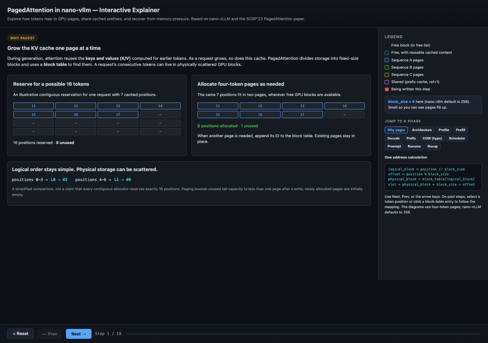

# PagedAttention Visualizer

An interactive walkthrough of how an LLM inference engine allocates, reads, shares, and releases its KV cache. Inspired by [nano-vLLM](https://github.com/GeeeekExplorer/nano-vllm), [vLLM](https://github.com/vllm-project/vllm), and the [PagedAttention paper](https://arxiv.org/abs/2309.06180).

The visualization follows nano-vLLM’s small implementation and uses concrete token IDs, four-token pages, and a 16-block pool to make its behavior visible.

## Demo



A 30-second preview of the interactive walkthrough. [View the animation at full size](assets/paged-attention-demo.gif), or [download the HTML](paged_attention_explainer.html) and open it locally to explore each step at your own pace.

## Open the Visualization

Download [paged_attention_explainer.html](paged_attention_explainer.html) and open it in a browser. Everything is contained in that one file: no installation, model weights, GPU, server, or network connection is needed. GitHub displays the HTML source; open the downloaded file locally to use the walkthrough.

Use **Next / Prev**, the **left and right arrow keys**, or **Jump to a phase**. On pool views, choose a sequence and token position, or click a block-table entry, to highlight its physical page and slot. The URL fragment records the current step, so reloading preserves it.

## Why Page the KV Cache?

During autoregressive generation, each attention layer computes a query, key, and value for the token being processed. Its query attends to keys and values from earlier positions and its own position, subject to the causal mask. Keeping those earlier keys and values in a **KV cache** avoids recomputing them on every decode step.

Requests have different prompt lengths and grow by different amounts. Reserving a large contiguous region for each request can leave unused capacity. Growing such allocations can also be difficult when free memory is scattered.

PagedAttention divides a request’s KV storage into fixed-size logical blocks and maps them to physical blocks in a shared GPU pool. A sequence’s blocks need not be adjacent. When it needs more capacity, the engine allocates another block and appends its ID to the sequence’s block table. Existing blocks stay in place.

The opening example compares an illustrative reservation for 16 positions with two four-token pages holding seven cached positions: nine unused slots versus one. Paging bounds unused tail capacity to less than one page after a write; newly allocated pages are initially empty.

## Follow a Token to Memory

For block size 4 and the block table `[2, 0, 1]`:

| Logical block | Token positions | Physical block |
| --- | --- | --- |
| L0 | 0–3 | #2 |
| L1 | 4–7 | #0 |
| L2 | 8–11 | #1 |

To locate the K/V for zero-based token position 9:

```text
logical block = 9 // 4 = 2
physical block = block_table[2] = 1
offset = 9 % 4 = 1
flat token slot = 1 × 4 + 1 = 5
```

A write uses this mapping to store K/V. Attention reads use the block table to access the scattered cached positions. These are token-slot indices, not byte addresses. Each visual slot stands for K/V vectors across the model’s layers; the number in the slot is the token ID, not the vector’s value.

Paging changes memory access and allocation. It does not change the mathematical definition of attention. nano-vLLM uses a Triton kernel for cache writes and FlashAttention’s block-table-aware functions for attention computation.

## The Walkthrough

1. **Why pages help:** compare reserved capacity with allocation as a request grows.
2. **Architecture and startup:** identify the scheduler, block manager, and workers; profile a large prefill and size the KV pool.
3. **Prefill:** allocate pages and scatter a prompt’s K/V into them.
4. **Decode:** distinguish a sampled token from its future K/V, then allocate and write at a page boundary.
5. **Prefix caching:** let two requests share a full prefix block and increment its reference count.
6. **Hypothetical copy-on-write:** show why beams sharing a partially filled block would need a copy when they diverge. This path is not implemented in nano-vLLM.
7. **Memory pressure:** follow five decode iterations and preempt a request when another needs a page.
8. **Cleanup and resume:** release references, retain reusable cached contents, and readmit the preempted request with a partial cache hit.

## Token IDs, Capacity, and Written K/V

After a seven-token prompt is processed, sampling appends an eighth token ID. At that moment the request has **eight token IDs but seven cached K/V positions**. The new token’s K/V is computed when that token is fed through the next forward pass.

With four-token pages, an input sequence length satisfying `len(seq) % 4 == 1` needs another page before its decode forward pass. Allocation follows the already sampled input token; sampling alone does not write its K/V.

The visualization distinguishes:

- **Solid slots:** K/V has been written for that token.
- **Dotted slots:** a token ID exists and capacity is allocated, but its K/V is pending.
- **Dashes:** unused capacity.
- **Red marks:** slots written by the displayed forward pass.
- **Purple blocks:** multiple sequences reference the same physical block.
- **Dashed cyan blocks:** no active references, but reusable cached contents remain.

During a forward-pass snapshot, written K/V can be ahead of `num_cached_tokens`: the scheduler updates that counter in postprocessing. Sequence cards label that distinction.

## Prefix Sharing and CoW

nano-vLLM hashes full blocks using their token IDs and the preceding prefix hash. A matching block can be reused by a new request; token IDs are also checked. An actively shared block has one reference per sequence using it. The engine can also reclaim a matching cached block from the free list.

Only complete prefix blocks are reused, and this checkout excludes the **final logical block** from lookup, even if it is full. A request therefore still has a suffix to process and produce its next-token logits. The suffix’s queries still attend to cached prefix K/V; a cache hit does not eliminate those attention reads.

Shared blocks in nano-vLLM are full and immutable. New writes go to a request’s private tail, so there is no need to copy a shared block. Full blocks containing previously generated tokens can also become reusable prefixes.

The paper’s parallel-sampling and beam-search examples can share a *partially filled* block. A write into such a shared block requires a private copy. The visualization labels this hypothetical example separately: nano-vLLM has no beam-search block-copy path.

## Recompute Does Not Always Mean Starting from Scratch

This nano-vLLM checkout uses **recompute preemption**, with no CPU KV swapping. When memory runs out, the scheduler can release another sequence’s pages and return that sequence to the waiting queue. Its token IDs survive, but its block table is cleared and its cached-token count resets.

Released blocks keep their contents and cached hashes until reused. On readmission, prefix lookup can find those same blocks again. The engine reuses the surviving matching prefix and processes the remaining suffix. With no surviving matching prefix, it re-prefills the entire sequence.

The example begins with A=11, B=9, and C=37 token IDs and three free pages:

| Decode iteration | Allocation event | Free pages after scheduling |
| --- | --- | --- |
| 1 | B takes #13; C takes #14 | 1 |
| 2 | No new page needed | 1 |
| 3 | A takes #15 | 0 |
| 4 | No new page needed | 0 |
| 5 | B needs a page; C releases 10 pages; B takes #14 | 9 |

An empty free list is not sufficient to trigger preemption: a scheduled request must need a new page.

After iteration 5’s forward pass, A samples EOS and releases its private pages. C can then resume with 41 token IDs. Its first nine full blocks—**36 positions**—survive. B has overwritten C’s old tenth block, so C processes a **five-token suffix**: four previously cached positions and one sampled token whose K/V has not yet been computed. Nothing was swapped to CPU.

## Source Map and Scope

The explanations were checked against nano-vLLM at commit [bb823b3](https://github.com/GeeeekExplorer/nano-vllm/tree/bb823b3e06983d71485a8e1f23715ebd87d98ef8). Later versions may differ.

| Concept | nano-vLLM source |
| --- | --- |
| Token counts and logical blocks | [sequence.py](https://github.com/GeeeekExplorer/nano-vllm/blob/bb823b3e06983d71485a8e1f23715ebd87d98ef8/nanovllm/engine/sequence.py) |
| Allocation, references, prefix hashing | [block_manager.py](https://github.com/GeeeekExplorer/nano-vllm/blob/bb823b3e06983d71485a8e1f23715ebd87d98ef8/nanovllm/engine/block_manager.py) |
| Scheduling, preemption, postprocessing | [scheduler.py](https://github.com/GeeeekExplorer/nano-vllm/blob/bb823b3e06983d71485a8e1f23715ebd87d98ef8/nanovllm/engine/scheduler.py) |
| Profiling, KV allocation, slot mappings | [model_runner.py](https://github.com/GeeeekExplorer/nano-vllm/blob/bb823b3e06983d71485a8e1f23715ebd87d98ef8/nanovllm/engine/model_runner.py) |
| K/V writes and FlashAttention calls | [attention.py](https://github.com/GeeeekExplorer/nano-vllm/blob/bb823b3e06983d71485a8e1f23715ebd87d98ef8/nanovllm/layers/attention.py) |

This is an educational sequence of snapshots, not a live inference engine or performance simulator. The JavaScript derives the pressure trace and its final snapshots from one small scheduling example; other scenes use explicit teaching states.

The diagrams use four-token pages; nano-vLLM defaults to 256. The illustrated noncontiguous allocation assumes a free-list order left by earlier requests; a freshly initialized pool starts with ascending block IDs. GPU memory proportions are illustrative, and profiling is a sizing measurement, not an OOM guarantee.

## References

- [nano-vLLM — GeeeekExplorer](https://github.com/GeeeekExplorer/nano-vllm): the compact implementation used as this walkthrough’s source reference.
- [vLLM](https://github.com/vllm-project/vllm): the inference and serving project that introduced PagedAttention. Modern vLLM supports a much broader set of features and need not behave exactly like this small implementation.
- [Efficient Memory Management for Large Language Model Serving with PagedAttention](https://arxiv.org/abs/2309.06180), Kwon et al., SOSP 2023: the original paper describing paging, sharing, and memory management for LLM serving.
- [FlashAttention](https://github.com/Dao-AILab/flash-attention): the attention implementation used by this nano-vLLM checkout, including paged KV-cache support.
